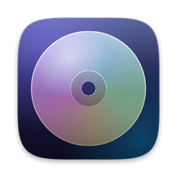

<div align="center">



# MacRipper

**Insert a disc. Get a perfectly tagged, organized library.**

A native macOS app that automatically detects, identifies, rips, transcodes and files your DVDs, Blu-rays,
audio CDs and data discs – inspired by the
[Automatic Ripping Machine](https://github.com/automatic-ripping-machine/automatic-ripping-machine),
rebuilt from scratch in SwiftUI with Liquid Glass.


[](https://github.com/d0minikh/macRipper/releases)


[Features](#features) ·
[Installation](#installation) ·
[Usage](#usage) ·
[Configuration](#configuration) ·
[FAQ](#faq--troubleshooting) ·
[Disclaimer](#disclaimer)

</div>

> [!WARNING]
> **This app is vibe coded.** MacRipper was written almost entirely by [Claude Code](https://claude.com/claude-code),
> Anthropic's AI coding agent, guided by prompts. It has automated tests and was tried with real hardware, but it
> has not been reviewed line by line by an experienced human developer. Read the [disclaimer](#disclaimer) before
> pointing it at your precious disc collection.

<!-- Screenshots: add images to docs/images and reference them here, e.g.
 -->

---

## Table of contents

- [Why MacRipper?](#why-macripper)
- [Features](#features)
- [Requirements](#requirements)
- [Installation](#installation)
- [Usage](#usage)
- [Configuration](#configuration)
- [Audio CDs: tags and covers](#audio-cds-tags-and-covers)
- [Tag Editor: tag the music you already have](#tag-editor-tag-the-music-you-already-have)
- [Notifications](#notifications)
- [Web interface and API](#web-interface-and-api)
- [FAQ & troubleshooting](#faq--troubleshooting)
- [Development](#development)
- [Acknowledgements](#acknowledgements)
- [Disclaimer](#disclaimer)

## Why MacRipper?

The [Automatic Ripping Machine (ARM)](https://github.com/automatic-ripping-machine/automatic-ripping-machine) is a
fantastic headless ripping server for Linux. MacRipper brings the same "insert a disc and walk away" workflow to the
Mac – as a real Mac app instead of a Docker container:

- **No server, no Docker, no udev rules** – disc detection uses macOS' own DiskArbitration.
- **A proper Mac interface** – sidebar, viewer and inspector like Final Cut Pro, an LCD like Logic Pro,
  Liquid Glass panels like Apple Music, menu bar extra, keyboard shortcuts.
- **Metadata you can trust** – MusicBrainz tags and the sharpest available cover art, editable before and after the rip.
- **Tools managed for you** – MakeMKV, HandBrakeCLI, FFmpeg and Apprise can be installed and updated from inside the app.

## Features

### 💿 Disc detection & identification
- Watches every optical drive and starts a job as soon as a disc is inserted – several drives in parallel.
- Recognizes **DVD, Blu-ray, audio CD and data discs**.
- Finds the real movie title from the volume label or the Blu-ray's `bdmt_*.xml`, then looks it up on
  **OMDb** or **TMDb** (title, year, movie or series, poster).
- A configurable **countdown** before ripping gives you time to correct the title and choose titles or tracks.

### 🎬 DVD & Blu-ray
- Rips with **MakeMKV** – individual titles as MKV or a full decrypted backup.
- Main feature only, minimum/maximum title length and protection against discs with 99 fake titles.
- Transcodes with **HandBrakeCLI** (separate presets for DVD and Blu-ray) or **FFmpeg**, with a limit for
  concurrent transcodes, or keeps the MKV untouched.
- Files everything into `movies/`, `tv/` or `unidentified/`, with extras in their own subfolder.

### 🎵 Audio CDs
- Looks the CD up by its **MusicBrainz disc ID** and lets you switch between matching editions.
- Writes **complete, Picard-style tags** to FLAC, ALAC, AAC, MP3 or WAV – including label, catalog number,
  barcode, ISRC, genre and all MusicBrainz IDs.
- Picks the **best cover** from Cover Art Archive and Apple Music (up to 3000 × 3000 px) and stores the original
  without recompression.
- **Edit everything by hand** – album fields, every track title and artist, the cover (drag and drop) – and write
  the changes back to already ripped files, renaming files and folders to match.

### 🏷️ Tag Editor
- Tags **music you already have** – single songs or whole albums, FLAC, Apple Lossless, AAC and MP3.
- Edit one song, a whole album or several albums at once; fields that differ show "Mixed" and take one value for all.
- Add songs and folders with the file dialog or by drag and drop.
- **Look up albums and songs on MusicBrainz**: MacRipper matches your files to the release's tracks and lets you
  correct the assignment before anything changes.
- Find the sharpest cover, number tracks, capitalize titles, fill tags from file names and **rename files** after
  their tags – with a preview.
- Nothing is written before you save, and tags MacRipper does not manage (lyrics, ReplayGain …) stay in the files.

### 🗂️ Data discs
- Creates a 1:1 ISO image of the disc, or a re-mastered ISO via `hdiutil`.

### 🔔 Notifications
- macOS notifications, **Pushover**, Pushbullet, IFTTT, ntfy, JSON webhooks and Apprise – each with its own switch.
- **Custom messages with variables** like `{title}`, `{duration}` or `{error}`.
- A post-job shell script for anything else.

### 🖥️ Interface
- Final Cut-style layout: library sidebar, viewer with tables, inspector with Info / Artwork / File tabs.
- Logic-style LCD in the toolbar with elapsed time, **estimated time remaining** and progress.
- Liquid Glass panels floating over the page, dark pro look by default (light and system appearance available).
- Menu bar extra, optional Dock icon, full keyboard control via the *Disc* menu.
- Optional **web interface** and JSON API to watch jobs from your phone.

<details>
<summary><b>Feature comparison with ARM</b></summary>

| ARM | MacRipper |
| --- | --- |
| udev rule detects inserted discs | DiskArbitration monitoring, multiple drives in parallel |
| Disc types DVD / Blu-ray / audio CD / data | Same (VIDEO_TS, BDMV, `.TOC.plist`, otherwise data) |
| Title lookup from label, OMDb/TMDb | Same, plus `bdmt_*.xml`, label cleanup, movie/series detection, posters |
| `MANUAL_WAIT` | Countdown with editable title, type and title/track selection, "Start Now" |
| MakeMKV `mkv` / `backup` (`RIPMETHOD`) | Same, `MAINFEATURE`, `MINLENGTH`/`MAXLENGTH`, 99-title protection |
| HandBrake / FFmpeg with presets | Same, `MAX_CONCURRENT_TRANSCODES`, `SKIP_TRANSCODE`, `DEST_EXT` |
| RAW → TRANSCODE → COMPLETED | Same, `DELRAWFILES`, extras subfolder |
| abcde + MusicBrainz | MusicBrainz disc ID, full Picard-style tags, best cover, tag editor and re-tagging |
| Data disc → ISO | 1:1 image or `hdiutil makehybrid` |
| Pushbullet, Pushover, IFTTT, Apprise, JSON, bash script | Same + macOS notifications, ntfy, message templates, per-service switches |
| Web UI | Native app, menu bar, optional web interface / JSON API |
| Auto eject | Same, optionally also on failure |

</details>

## Requirements

| | |
| --- | --- |
| **macOS** | 26 (Tahoe) or later – the interface uses Liquid Glass |
| **Hardware** | An optical drive (internal, USB or Thunderbolt). Blu-ray needs a drive MakeMKV supports. |
| **Mac** | Apple silicon or Intel (universal app) |
| **To build** | Only when building from source: Xcode 26 or later, or the Swift toolchain of the Command Line Tools |
| **DVD / Blu-ray** | [MakeMKV](https://www.makemkv.com) |
| **Transcoding** | [HandBrakeCLI](https://handbrake.fr) (or FFmpeg) |
| **Optional** | [FFmpeg](https://ffmpeg.org) (FFmpeg transcoder, MP3), [Apprise](https://github.com/caronc/apprise), [Homebrew](https://brew.sh) |

You don't have to install the tools by hand: the **Tools** page in the app installs and updates them (see below).

## Installation

> [!NOTE]
> MacRipper is in **beta**. The current release is a pre-release – expect bugs and keep backups of anything
> important.

### Option A: Download (easiest)

Get the latest version from the [**Releases page**](https://github.com/d0minikh/macRipper/releases). Each release
comes in two flavors – pick one:

| File | How to install |
| --- | --- |
| `MacRipper-<version>.dmg` | Open the disk image and drag **MacRipper** onto the **Applications** folder. |
| `MacRipper-<version>.pkg` | Double-click the installer and follow the steps. It puts MacRipper into `/Applications`. |

`SHA256SUMS.txt` lists the checksums, so you can verify a download with
`shasum -a 256 -c SHA256SUMS.txt` in the download folder.

**"MacRipper can't be opened" / "Apple could not verify …"** – the releases are not yet signed with an Apple
Developer ID or notarized, so macOS blocks them on the first launch. To allow MacRipper once:

1. Try to open the app (or the `.pkg`) and close the warning.
2. Open **System Settings → Privacy & Security**, scroll down and click **Open Anyway** next to the MacRipper
   message, then confirm with your password or Touch ID.

Alternatively, after copying the app to `/Applications`, remove the download quarantine in Terminal:

```bash
xattr -dr com.apple.quarantine /Applications/MacRipper.app
```

To update, install the new version over the old one – your settings, job history and Keychain entries stay in place.

### Option B: Build with Xcode

```bash
git clone https://github.com/d0minikh/macRipper.git
cd macRipper
open macRipper.xcodeproj
```

Press **⌘R** to build and run, **⌘U** to run the tests. Xcode puts the finished app into `build/Debug/MacRipper.app`
(or `build/Release/MacRipper.app` for the Release configuration).

Out of the box the project has no team and signs the app "to run locally", which works fine on your own Mac.
To sign with your own Apple Developer account, keep your team out of the project file and put it into a local,
git-ignored config instead:

```bash
cp Config/Signing.local.xcconfig.example Config/Signing.local.xcconfig
```

Then replace the placeholder team ID in `Config/Signing.local.xcconfig` with yours. Don't pick a *Team* under
*Signing & Capabilities* – Xcode would write it into `project.pbxproj`. A signed build keeps a stable signature, so
macOS remembers the permissions you grant MacRipper between builds.

<details>
<summary><b>Distributing to other Macs</b></summary>

Use *Product → Archive*, then *Distribute App → Direct Distribution* (Developer ID, notarized). The release
configuration already enables the hardened runtime. MacRipper cannot run in the App Sandbox – it reads raw disc
devices, launches MakeMKV/HandBrake/FFmpeg and installs tools – so it is meant for direct distribution, not the
Mac App Store.

</details>

### Option C: Build on the command line

```bash
./scripts/build-app.sh
open build/MacRipper.app
```

The script builds a release version with SwiftPM, signs it ad hoc and puts it into `build/`. Keep the bundle ID and
version at the top of the script in sync with the Xcode project.

### First launch

1. Open **Tools** in the sidebar and install what's missing:
   - **MakeMKV** is downloaded from makemkv.com, its SHA-256 checksum is verified against the published one and
     the app is copied to `/Applications`.
   - **HandBrakeCLI, FFmpeg, Apprise** are installed with Homebrew. If Homebrew itself is missing, the app shows the
     official install command for Terminal.
2. For movie titles and posters, add an **OMDb** or **TMDb** API key in *Settings → Metadata*
   ([OMDb](https://www.omdbapi.com/apikey.aspx), [TMDb](https://www.themoviedb.org/settings/api)).
3. Insert a disc. 🎉

## Usage

1. **Insert a disc.** MacRipper detects it, identifies it and selects the new job.
2. **Check the details** during the countdown – title and year for movies, album, tracks and cover for CDs.
   Edit anything in the table or the inspector, or press **Start Now**.
3. **Walk away.** The LCD in the toolbar shows what runs and how long it will take. The disc is ejected when ripping
   is done; transcoding continues in the background so the next disc can go in right away. While a job runs,
   MacRipper keeps the Mac from going to sleep on its own (the display may still turn off).
4. **Find your files** in `~/Movies/MacRipper/completed`, `~/Music/MacRipper` or `~/Documents/MacRipper/ISO`.

### Keyboard shortcuts

| Shortcut | Action |
| --- | --- |
| ⌘R | Rip inserted disc(s) |
| ⌘E | Eject disc |
| ⌘↩ | Start now (skip the countdown) |
| ⌘. | Abandon job |
| ⇧⌘F | Search metadata |
| ⇧⌘T | Write tags to files (audio CDs) |
| ⇧⌘L | Show log |
| ⌘O | Add music to the Tag Editor |
| ⌘S | Save tags (Tag Editor) |
| ⌥⌘F | Look up on MusicBrainz (Tag Editor) |
| ⌥⌘I | Show / hide inspector |
| ⌘1 / ⌘2 / ⌘3 | Drives / Tools / Tag Editor |
| ⌘, | Settings |

## Configuration

Everything lives in **Settings (⌘,)**:

| Tab | What you set there |
| --- | --- |
| **General** | Appearance, Dock / menu bar icon, auto rip, countdown, auto eject, output folders |
| **Video** | Rip method, main feature only, title length limits, transcoder and presets, extras folder |
| **Audio & Data** | Audio format, MusicBrainz lookup, cover art, file name patterns, ISO mode |
| **Metadata** | OMDb / TMDb provider and API keys |
| **Notifications** | Events, message templates, notification services |
| **Advanced** | Web interface, tool paths, post-job script |

**Where things are stored**

| What | Where |
| --- | --- |
| Settings | `~/Library/Application Support/MacRipper/config.json` |
| API keys, tokens, notification URLs | macOS Keychain (never in `config.json`) |
| Job history | `~/Library/Application Support/MacRipper/jobs.json` |
| Job logs | `~/Library/Logs/MacRipper/` |

**Default output layout**

```text
~/Movies/MacRipper/
├── raw/          MakeMKV output while ripping
├── transcode/    files being transcoded
└── completed/
    ├── movies/Inception (2010)/Inception (2010).mkv
    ├── tv/…
    └── unidentified/…
~/Music/MacRipper/Daft Punk/Discovery (2001)/01 - One More Time.flac
~/Documents/MacRipper/ISO/BACKUP_2019.iso
```

Audio folder and file names follow patterns with the placeholders `{artist}`, `{albumartist}`, `{trackartist}`,
`{album}`, `{year}`, `{genre}`, `{disc}`, `{track}` and `{title}`.

## Audio CDs: tags and covers

| Tag | FLAC | MP3 | M4A |
| --- | :-: | :-: | :-: |
| Title, artist, album, album artist, date, genre, track/disc number and total, compilation | ✓ | ✓ | ✓ |
| Label, comment, composer | ✓ | ✓ | ✓ |
| Album artist sort | ✓ | ✓ | ✓ |
| Original date, catalog number, barcode, ISRC, country, media | ✓ | ✓ | ✓ |
| MusicBrainz IDs (release, release group, artists, recording, release track, disc ID) | ✓ | ✓ | ✓ |
| Front cover | ✓ | ✓ | ✓ |

FLAC uses Vorbis comments, MP3 ID3v2.4, ALAC/AAC iTunes atoms (with freeform atoms for the extra fields) – field
names follow [MusicBrainz Picard](https://picard.musicbrainz.org).

**Cover art:** MacRipper compares the cover of the exact edition and of the album on Cover Art Archive with the
Apple Music artwork and keeps the sharpest square one. The original is saved next to the music as
`cover.jpg` / `cover.png`; for embedding it is used as is up to 3000 px (configurable) and scaled down otherwise.
*Find Covers…* in the inspector shows all candidates, and you can drop any image onto the cover.

**Unknown CDs** are not ripped until you identified them – search MusicBrainz by artist and album, paste a
MusicBrainz release link, or type the tags yourself.

## Tag Editor: tag the music you already have

The **Tag Editor** in the sidebar (⌘3) tidies up music that is already on your Mac – ripped by MacRipper or
anything else. It reads and writes FLAC, Apple Lossless/AAC (`.m4a`) and MP3 with the same fields as the table
above.

1. **Add music** with the + button (⌘O) – songs and whole folders, several at once – or drop songs or folders onto
   the Tag Editor or the sidebar. Folders are searched completely. Files are grouped into albums by folder and
   album tag; songs without an album tag form a group per folder. Every album appears in the sidebar.
2. **Edit.** Double-click an album (or choose it in the sidebar) to see its songs. To edit several albums at once –
   for example to set the same genre or label – select them in the cover grid with ⌘-click or ⇧-click (or *Select
   All*); the inspector then edits all their songs. Titles and artists can be edited right in the table; the inspector
   edits everything else. With no song selected, the inspector edits the whole album; with several songs
   selected, fields that differ show *Mixed* – typing a value sets it for all of them.
3. **Look it up.** *Look Up on MusicBrainz* (⌥⌘F) searches for the album, or paste a release link. After you choose
   a release, MacRipper assigns your files to its tracks – by title and position, then title, then position, then
   length – and shows the result, so you can correct it before applying. *Look Up Song…* (context menu or
   inspector) finds a single song by title and artist; it gets the tags of the album you choose. The best cover of
   the release can be taken over at the same time.
4. **Covers.** *Find Covers…* shows Cover Art Archive and Apple Music candidates; you can also choose a file or drop
   an image onto the cover. *Save as cover.jpg in Folder* puts the album's cover next to its files.
5. **Tidy up.** The context menu of the table numbers tracks in order, capitalizes titles, fills tags from file
   names like `03 - Artist - Title`, and *Rename Files…* renames files after their tags (with a preview, using the
   file name pattern from Settings).
6. **Save** (⌘S). Changed songs are marked with an orange dot until you save; *Revert Changes* discards edits.

Saving only replaces the fields MacRipper manages and keeps everything else in the file – lyrics, ReplayGain,
ratings, other pictures, gapless information. Tags of all three formats are written directly by MacRipper, without
FFmpeg; the audio itself is never touched.

## Notifications

Pick the events (rip started, job finished, job failed), write your own title and message for each, and turn the
services on or off individually. Variables go in braces – the ⓘ button in the settings lists them all:

```text
MacRipper: {title} is ready
{type} finished in {duration}.
```

<details>
<summary><b>All message variables</b></summary>

| Variable | Meaning | Example |
| --- | --- | --- |
| `{title}` | Display title: movie with year, or "Artist – Album" | Inception (2010) |
| `{name}` | Title without the year (album name for CDs) | Inception |
| `{year}` | Release year | 2010 |
| `{type}` | DVD, Blu-ray, Audio CD or Data Disc | Blu-ray |
| `{kind}` | Movie or Series | Movie |
| `{artist}` | Artist (audio CDs) | Daft Punk |
| `{album}` | Album (audio CDs) | Discovery |
| `{label}` | Volume label of the disc | INCEPTION |
| `{status}` | Job status | Finished |
| `{error}` | Error message (failed jobs only) | makemkvcon exited with code 1 |
| `{duration}` | How long the job took | 1 hr, 12 min |
| `{duration_hms}` | Same as h:mm:ss | 1:12:05 |
| `{started}` | When the disc was inserted | 23 Oct 2026, 16:10 |
| `{finished}` | When the job ended | 23 Oct 2026, 17:22 |
| `{titles}` | Number of selected titles or tracks | 1 |
| `{path}` | Output folder or file | ~/Movies/MacRipper/completed/movies/Inception (2010) |
| `{drive}` | Name of the optical drive | BD-RE Drive |
| `{imdb}` / `{imdb_url}` | IMDb ID / link | tt1375666 |
| `{host}` | Name of this Mac | Studio |
| `{job_id}` | Unique job ID | DF3294A0-… |

Unknown variables are left as typed, so typos are easy to spot. The JSON webhook receives all variables in its
`job` object. Dates and durations follow your region settings.

</details>

**Post-job script:** *Settings → Advanced* runs a script of your choice after every successful job, with the
arguments title, output path, disc type and status.

## Web interface and API

Enable it in *Settings → Advanced*. MacRipper then serves a small page with running jobs and the history, plus a
JSON API:

| Request | Description |
| --- | --- |
| `GET /api/jobs` | All jobs as JSON |
| `GET /api/jobs/<id>/log` | Log of a job |
| `POST /api/jobs/<id>/start` | Skip the countdown |
| `POST /api/jobs/<id>/abandon` | Abandon a running job |

Every request needs the access token (`?token=…` or the `X-MacRipper-Token` header); the app generates one and
offers a link that contains it. By default the server only listens on `localhost` – turn on *Allow access from other
devices* to reach it from your phone.

## FAQ & troubleshooting

<details>
<summary><b>macOS keeps asking whether MacRipper may access its Keychain item.</b></summary>

API keys are stored in the Keychain, and the Keychain ties access to the app's code signature. Ad-hoc signed builds
get a new signature with every build, so macOS asks again – choose *Always Allow*. Signing with your own Apple
Developer team (see [Installation](#option-a-xcode-recommended)) gives the app a stable identity and the prompts stop.
</details>

<details>
<summary><b>Ripping a Blu-ray is extremely slow or fails.</b></summary>

That happens inside MakeMKV. Check the job log (⇧⌘L): messages like *"AACS host certificate is revoked by your
drive"* mean the drive's firmware rejects MakeMKV's key. Updating MakeMKV (Tools page) or using a drive supported by
MakeMKV's LibreDrive mode usually helps.
</details>

<details>
<summary><b>A movie ends up in <code>unidentified/</code>.</b></summary>

No OMDb/TMDb key is configured or the label could not be matched. Add a key in *Settings → Metadata*, or search the
title yourself during the countdown (⇧⌘F).
</details>

<details>
<summary><b>The disc is not ejected or the drive is missing.</b></summary>

The job log (⇧⌘L) shows every eject attempt and, if it fails, the reason macOS gives. A drive that has just finished
reading can stay locked for a few seconds, so MacRipper retries and forces the unmount if needed. If a drive or disc
is missing after the Mac woke up, click **Refresh Drives** in the toolbar – MacRipper also does this by itself a few
seconds after waking. Discs found this way are not ripped automatically; click **Rip** on the Drives page.
</details>

<details>
<summary><b>An audio CD is not found on MusicBrainz.</b></summary>

Search by artist and album, paste a MusicBrainz release link, or enter the tags by hand. The search dialog also
links to MusicBrainz so you can add the disc there – then it will be recognized next time for everyone.
</details>

<details>
<summary><b><code>swift test</code> fails with "plugin for module 'TestingMacros' not found".</b></summary>

The Command Line Tools sometimes lack compiler plugins. Run the tests with Xcode's toolchain:

```bash
DEVELOPER_DIR=/Applications/Xcode.app/Contents/Developer swift test
```

or make Xcode the default once: `sudo xcode-select -s /Applications/Xcode.app/Contents/Developer`.
</details>

### Known limitations

- Audio CDs are read through the AIFF files macOS provides – there is no secure ripping / AccurateRip verification.
- The 1:1 ISO needs read access to `/dev/rdiskN`; without it the image is re-mastered with `hdiutil`.
- ARM's online CRC64 database for DVD identification is not used.
- The Tag Editor identifies music by its tags, file names and lengths – there is no acoustic fingerprinting
  (AcoustID). Its list of loaded files is not kept when you quit the app; unsaved changes are lost.
- The interface is in English; dates and numbers follow your region settings.

## Development

```text
Sources/MacRipper/
├── App/        App entry, menu commands, debug helpers
├── Models/     Job, configuration, audio metadata
├── Rippers/    MakeMKV, transcoding, audio CD and data disc ripping, tag writers
├── Services/   Disc monitor, job pipeline, metadata, covers, notifications, web server, tool installer
└── Views/      SwiftUI interface
Tests/MacRipperTests/   Unit and integration tests (Swift Testing)
scripts/                build-app.sh, make-icon.swift
```

Run the tests with ⌘U in Xcode or `swift test`. Live tests against MusicBrainz, Cover Art Archive and Apple Music
run with `MACRIPPER_NETWORK_TESTS=1`.

Debug builds started from Xcode use the same history and settings as the installed app. Test runs, and launches
with any of the following environment variables (pre-configured but switched off in the Xcode scheme), keep their
data in `~/Library/Application Support/MacRipper-Debug` and use a separate Keychain item instead:

| Variable | Effect |
| --- | --- |
| `MACRIPPER_DEMO=1` | Adds sample jobs |
| `MACRIPPER_SELECT=tools\|history` | Opens Tools or the newest history job |
| `MACRIPPER_INSPECTOR=0\|1` | Hides or shows the inspector on launch |
| `MACRIPPER_SETTINGS_TAB=<tab>` | Opens Settings on a tab |
| `MACRIPPER_RIP_PRESENT=1` | Starts jobs for discs that are already inserted |
| `MACRIPPER_SNAPSHOT=/path/prefix` | Saves PNG snapshots of the windows (`MACRIPPER_SNAPSHOT_DELAY` sets the delay) |
| `MACRIPPER_INSPECTOR_WINDOW=info\|artwork\|file` | Shows the inspector in a plain window (snapshots cannot capture Liquid Glass) |
| `MACRIPPER_CLEAR_HISTORY=<seconds>` | Clears the history after a delay |

<details>
<summary><b>Why <code>@ViewState</code> instead of <code>@State</code>?</b></summary>

In the macOS 26+ SDKs SwiftUI's `@State` is a compiler macro whose plugin only ships with Xcode. The alias in
`Views/ViewState.swift` uses the underlying property wrapper, so the project also builds with the Command Line Tools.
</details>

## Acknowledgements

- [Automatic Ripping Machine](https://github.com/automatic-ripping-machine/automatic-ripping-machine) – the idea and
  the feature set this app follows.
- [MakeMKV](https://www.makemkv.com), [HandBrake](https://handbrake.fr), [FFmpeg](https://ffmpeg.org) and
  [Apprise](https://github.com/caronc/apprise) – the tools that do the heavy lifting.
- [MusicBrainz](https://musicbrainz.org) and the [Cover Art Archive](https://coverartarchive.org) – open music
  metadata; please contribute missing discs.
- [OMDb](https://www.omdbapi.com) and [TMDb](https://www.themoviedb.org) – movie metadata.
- [Claude Code](https://claude.com/claude-code) by Anthropic – wrote the code.

## Disclaimer

**Vibe coded with Claude Code.** This project was created by describing features and design wishes in plain
language to [Claude Code](https://claude.com/claude-code), Anthropic's agentic coding tool, which wrote, tested and
debugged the code. The human contribution was the direction, testing with real discs and feedback – not
line-by-line programming. That means:

- The code may contain bugs, edge cases and design decisions nobody has looked at closely.
- It works with your files, external tools and the network. **Keep backups** and try it with discs you can
  re-rip before relying on it.
- The software is provided **"as is", without warranty of any kind**. Use it at your own risk.

**Legal.** Only rip discs you own, and only where the law allows it. In many countries – including Germany, the EU
and the US – circumventing copy protection (e.g. CSS on DVDs or AACS on Blu-rays) is prohibited even for private
copies. You are responsible for complying with the laws that apply to you. MakeMKV is third-party software with its
own license terms.

MacRipper is an independent project and is not affiliated with or endorsed by Apple, Anthropic, the Automatic
Ripping Machine project, MakeMKV, HandBrake, MusicBrainz or any other project or service mentioned here.
